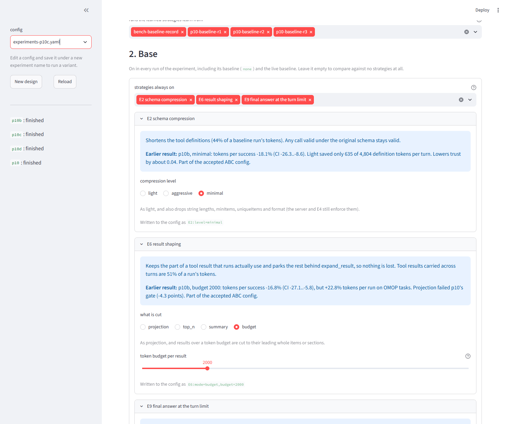
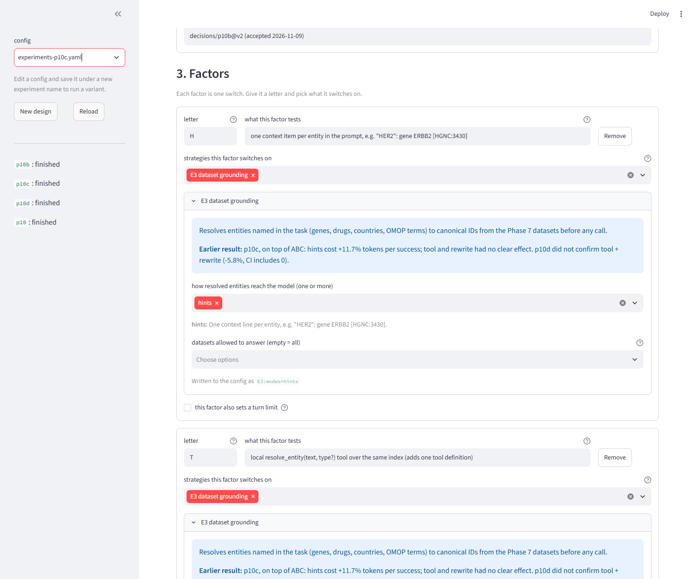
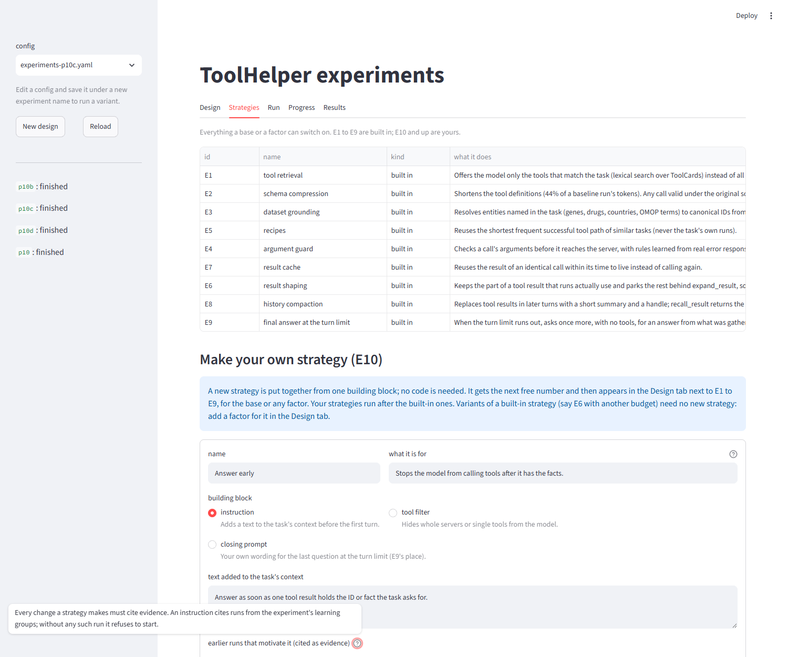
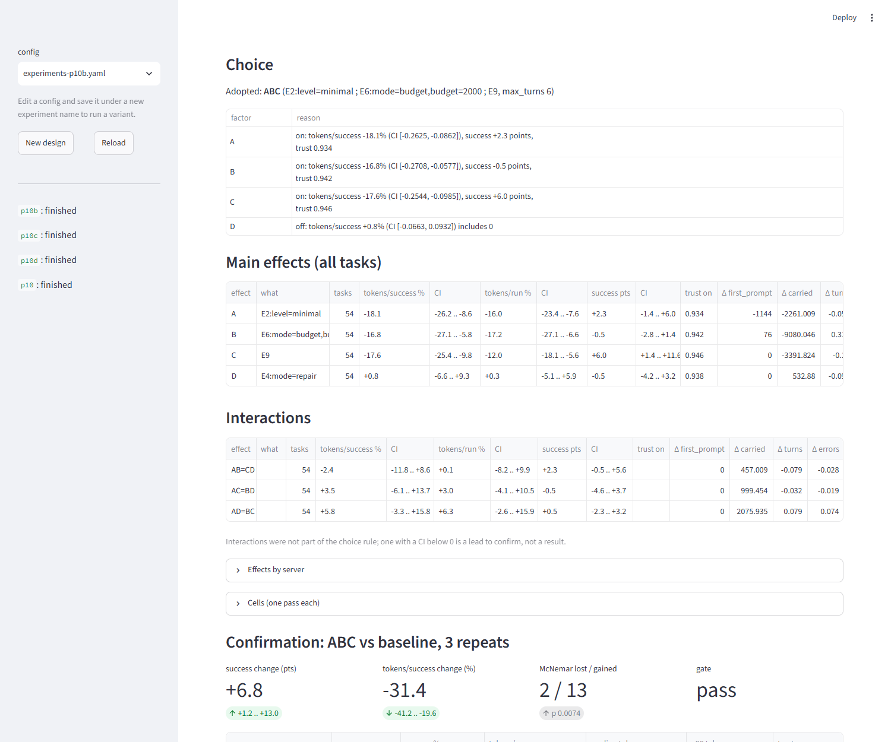

# ToolHelper

ToolHelper monitors how LLM agents call the tools of three biomedical MCP servers (Medical MCP, BioMCP and OMOP MCP) and makes those calls cheaper, while keeping every change traceable. It follows WarmHub's principles: context that is trusted, curated, versioned, permissioned, timely and usable at scale.

It has two parts:

- **Monitoring:** exact token usage per tool call, how the model reaches each tool (its pathway), and statistics a human can act on.
- **Efficiency:** strategies, several of them backed by public datasets, that reduce the tokens needed to call these tools. Every strategy is tested in experiments, the optimum is chosen with an explicit decision log, and each change carries a trust score and evidence.

Ollama is the default LLM in the plan, and any other backend can be swapped in to rerun the same experiments. The reported experiments ran on Mistral Large 4 through NVIDIA's hosted API, because the local model ran out of memory.

> **Status:** Phases 0 to 10 are built; [Results](#results-what-made-tool-calls-cheaper) reports what the experiments found. Phases 11 and 12 are not started. The rest of this README is the specification the prototype was built from, phase by phase, in Claude Code.
>
> **Verified on 2026-11-01:** items marked *verified* were checked against the servers' source code and the SDK versions installed from PyPI and npm on that date. Versions drift, so Phase 2 re-checks them against the live servers.
>
> **Medical data notice:** the underlying servers return information for research and education. ToolHelper measures and optimizes tool calls; it does not provide medical advice.

## Contents

- [Results: what made tool calls cheaper](#results-what-made-tool-calls-cheaper)

1. [Verified metadata](#1-verified-metadata)
2. [Architecture](#2-architecture)
3. [Build steps](#3-build-steps)
4. [Gotchas](#4-gotchas)
5. [Working rules and build notes](#5-working-rules-and-build-notes)
6. [References](#6-references)

---

## Results: what made tool calls cheaper

Phases 0 to 10 are built and the experiments have run. This section reports what they found; the build steps in section 3 remain the specification.

**The accepted configuration cuts tokens per successful task by 31% and solves more tasks.** It combines three changes (called ABC in the experiments) and is recorded as `decisions/p10b@v2`, accepted on 2026-11-09:

| | Change | Setting |
|---|---|---|
| A | Schema compression (E2) | `E2:level=minimal` |
| B | Result shaping (E6) | `E6:mode=budget,budget=2000` |
| C | Final answer at the turn limit (E9) | `E9` with `max_turns` 6 instead of 8 |

Run it with:

```
toolhelper bench run --strategy E2:level=minimal --strategy E6:mode=budget,budget=2000 --strategy E9 --max-turns 6
```

### Measured gain

All numbers are measured tokens on the 54-task benchmark with Mistral Large 4 (`nim-mistral`), 19 tools offered.

| Comparison | Success | Tokens per successful task | Trust |
|---|---|---|---|
| Replay, 3 paired repeats: baseline | 88.3% | about 52,300 | about 0.97 |
| Replay, 3 paired repeats: ABC | 95.1% | 35,902 | 0.923 |
| Live servers, 27 tasks, 1 run: baseline | 88.9% | 53,596 | 0.970 |
| Live servers, 27 tasks, 1 run: ABC | 92.6% | 34,823 | 0.919 |

- **Tokens per success:** −31.4% in replay (95% CI −41.2% to −19.6%) and −35% live.
- **Success:** +6.8 points in replay (CI +1.2 to +13.0). ABC gained 13 tasks and lost 2 (McNemar p = 0.0074).
- **Trust:** stays above the 0.9 gate but falls by about 0.05.

### Where the tokens went

The baseline runs showed two cost centres, and the three changes aim at them:

- **Tool results carried across turns: 51% of a run's tokens.** Every result is re-sent on each later turn.
- **Tool definitions: 44%.** All 19 definitions cost 4,804 prompt tokens and are re-sent every turn; `biomcp__search` alone costs 1,489.

### What each change contributed

Effects are from the p10b fractional factorial (8 cells × 54 tasks, paired by task, bootstrap 95% CIs).

| Change | Tokens per success | Success | How it saves |
|---|---|---|---|
| A: E2 minimal | −18.1% (−26.3 to −8.6) | +2.3 points | Drops schema bounds that only reject values (string lengths, `minItems`, `uniqueItems`, `format`), most of BioMCP's schema tokens. The first-turn prompt shrinks by 1,144 tokens per run. Calls valid under the original schema stay valid. |
| B: E6 budget 2000 | −16.8% (−27.1 to −5.8) | −0.5 points | Cuts results over 2,000 tokens to their leading whole items or sections and parks the rest behind `expand_result`. Carried results fall by 9,080 tokens per run, at 0.25 extra expand calls per run. |
| C: E9, 6 turns | −17.6% (−25.4 to −9.9) | +6.0 points (+1.4 to +11.6) | Stops turn loops: after six tool turns the model is asked once, with no tools, to answer from what it gathered. This is the only change that clearly raises success. |

No interaction between the three was distinguishable from zero, so their savings add up.

### What did not work

| Strategy | Result | Why |
|---|---|---|
| E2 light | No difference over 3 repeats (+0.3%, CI −15.3% to +20.5%) | It saves only 635 of the 4,804 definition tokens per turn. |
| E4 argument guard (repair) | Tokens +0.8% (CI includes 0) | Argument errors fell by 0.45 per run, but that did not reduce tokens. |
| E1 tool retrieval | Success −9.9 points | Retrieval dropped BioMCP tools that tasks needed. |
| E8 history compaction (after use) | Success −11.7 points, tokens per success +36.6% | It hid facts the model still needed. |
| E6 projection | Success −4.3 points, tokens per success +15.2% | It only trims unused fields of three tools. |
| E5 recipes | +20.6% tokens per success when added to E2 light | |
| E7 cache | +3.4% tokens per success, success −0.6 points | |
| E3 grounding on top of ABC: hints | +11.7% tokens per success (CI +1.9% to +22.4%) | Hints add carried tokens and 0.5 more errors per run. |
| E3 on top of ABC: tool, rewrite | No clear effect (−3.3% and +0.6%, CIs include 0) | |
| E3 tool + rewrite together | Not confirmed: −5.8% (CI −14.1% to +3.5%) | A lead from one factorial that shrank on fresh runs. |

The E1, E5, E7, E8 and E6 projection results come from one or two runs per strategy in the first iteration, so treat their exact sizes with caution.

### What made the experiments work

- **Single runs are noise.** The per-task spread between identical runs is 0.29 in log tokens, so one run per arm detects only changes of about 14%, and three runs about 8.5%. A −14% result for E2 light from one run disappeared over three repeats.
- **Diagnose before testing.** The first iteration (p10: singles, then greedy selection) found nothing, because its variants barely touched the two cost centres. The second iteration first computed each variant's saving on the existing baseline traces and tested only variants large enough to detect.
- **A fractional factorial beats one-at-a-time arms.** Each factor's effect compares half of all runs with the other half, so 8 passes measured four factors and their interactions.
- **Fix the choice rule in advance, then confirm on fresh runs.** A factor is adopted when its tokens-per-success CI lies below 0, success holds within 2 points and trust stays at or above 0.9.
- **Keep the replay set honest.** Recordings of an API outage and of rate-limit errors reported as empty results had to be archived and re-recorded before the second iteration. That repair is also why its baseline (88.3%) is higher than the first iteration's (82.1%).

### Limits

- **One model.** All results are for Mistral Large 4 on NVIDIA's hosted API, which is not seed-reproducible. Phase 11 (rerun on another LLM) has not started.
- **Result shaping costs tokens on OMOP tasks:** +22.8% tokens per run there (CI +5.8% to +45.3%). A per-server setting that turns B off for OMOP has not been tested.
- **Trust falls by about 0.05,** from the compressed-schema fidelity penalty and the result cuts.
- **Trust measures consistency with evidence, not correctness.** A wrong answer that matches what a server returned still scores 1.0.
- **54 tasks.** Intervals are wide; the live check is one run on 27 tasks.

### Reproducing and extending

- Experiment configs are `configs/experiments.yaml` (p10) and `configs/experiments-p10b.yaml`, `-p10c.yaml`, `-p10d.yaml`. Run one with `toolhelper experiment freeze|auto|status --config <file>`.
- `uv run --extra dashboard toolhelper experiment app` opens a local app to design, launch and read experiments, shown below.

### The experiment app

The app runs on `localhost:8501` and has five tabs: Design, Strategies, Run, Progress and Results. It reads and writes the same config files and uses the same `toolhelper experiment` commands as the CLI, so anything started in it can be continued from the terminal. The screenshots are from 2026-11-10.

**Design: strategies with their settings.** A base or factor picks strategies from a list. Each one shows what it does and what earlier experiments measured for it, and its settings are choices and sliders (here E6's token budget). The line under each strategy shows the spec that is written to the config.



**Design: factors.** Each factor is a card with a letter, a note and the strategies it switches on. Further down, "Add factor" creates a new card with the next free letter, and factors can be taken over from another config, either as factors or into the base. The design type (full factorial, fraction or confirm only), the gate and the number of repeats are set the same way.



**Strategies: making your own.** The tab lists E1 to E9 and defines further ones (E10 and up) without code, from one of three building blocks: an instruction added to the task's context, a filter that hides servers or tools, or your own closing prompt at the turn limit. Definitions are saved to `configs/strategies.yaml` and then appear in the Design tab. None of these has been measured yet; the form below is filled in as an example and was not saved.



**Results.** For p10b: the factors the choice rule adopted with its reasons, each factor's effect with 95% intervals and the mechanism columns (first-turn prompt, carried tokens, turns, errors), the interactions, and the confirmation against the baseline.



The Run tab freezes the inputs, launches or pauses the run and approves the Decision; the Progress tab shows each group's completed tasks and the orchestrator log.

---

## 1. Verified metadata

### 1.1 The three MCP servers

| | Medical MCP | BioMCP | OMOP MCP |
|---|---|---|---|
| Source | `JamesANZ/medical-mcp` (TypeScript, MIT) | `genomoncology/biomcp` (Rust, MIT) | `OHNLP/omop_mcp` (Python, Apache-2.0) |
| Version checked | npm `medical-mcp` 1.0.8 | 0.9.4 (commit of Oct 30, 2026) | 0.2.0 (commit of May 10, 2026) |
| Install | none (runs via npx) | `uv tool install biomcp-cli` | `git clone https://github.com/OHNLP/omop_mcp.git` |
| Launch (stdio) | `npx -y medical-mcp` | `biomcp serve` | `uv --directory <repo> run omop_mcp` |
| Keys | none | none for core sources | `OMOPHUB_API_KEY` |
| Tools | 10 | 7 | 2, plus 3 resources and 1 prompt |

- For BioMCP, install `biomcp-cli`; the PyPI package named `biomcp` is a different, unrelated project. The same binary also has an HTTP mode and works as a standalone CLI.
- For OMOP MCP, the server does its vocabulary search and mapping through the OMOPHub API (`https://api.omophub.com/v1`), and you get the key from omophub.com.
- Medical MCP's README describes a cache with per-source lifetimes: FDA data 24 hours, PubMed 1 hour, WHO 7 days, RxNorm 30 days. Check whether your installed version has it before crediting ToolHelper's cache for latency wins. Those lifetimes are good defaults for your own freshness policy.

#### Medical MCP tools (verified from `build/index.js`)

| Tool | Arguments |
|---|---|
| `search-drugs` | `query` (brand or generic), `limit` 1–50, default 10 |
| `get-drug-details` | `ndc` (matched against openFDA `product_ndc`) |
| `get-health-statistics` | `indicator` (substring of a WHO indicator name), `country` (ISO3 such as `USA`, optional), `limit` 1–20 |
| `search-medical-literature` | `query`, `max_results` 1–20 |
| `get-article-details` | `pmid` |
| `search-drug-nomenclature` | `query` (RxNorm) |
| `search-google-scholar` | `query` |
| `search-clinical-guidelines` | `query`, `organization` (optional) |
| `search-medical-databases` | `query` |
| `search-medical-journals` | `query` |

Medical MCP behaviors that create efficiency targets:

- **Dead end:** `search-drugs` returns markdown with brand, generic, manufacturer, route and form, but no NDC. `get-drug-details` needs an NDC, so search followed by details stalls and the model starts guessing. An NDC dataset fixes this directly.
- **Country codes:** `get-health-statistics` wants a 3-letter code, but models send "Japan" or "United States".
- **Overlapping tools:** four literature tools overlap heavily, which causes wrong-tool-first calls.
- **Stray stdout line:** the server prints a startup line to stdout, so your client must tolerate one non-JSON line.
- **Tool list drift:** the GitHub README lists more tools than npm 1.0.8 has. Always snapshot the live tool list.

#### BioMCP tools (verified from `src/mcp/catalog.rs` and `src/mcp/shell.rs`)

| Tool | Arguments |
|---|---|
| `biomcp` | `command` (one read-only CLI command, e.g. `get gene BRAF pathways`), `json` |
| `search` | `entity` ∈ author, gene, pgx, gwas, article, trial, variant, protein; `limit` 1–25 (default 10); `offset` 0–1000; `json`; plus per-entity fields |
| `get` | `entity` ∈ gene, variant, article, author, trial, diagnostic, drug, disease, pgx, pathway, cell-line, protein, adverse-event; `id`; `sections[]`; `json`; also variant `assembly`, trial `source` (ctgov or nci), article `pdf` |
| `variant_normalize_car` | `inputs`: 1–50 RefSeq HGVS strings |
| `variant_erepo` | `caid`, `caids` (1–50) or `gene`; `limit` 1–100; `offset`; `detail`; `assertion_id`; `version` |
| `gene_cspec` | `gene`; optional `version_iri`, `capture_id`, `files` |
| `variant_articles` | `items` (1–10 variants), `strategy`, `limit` 1–50, `offset`, `verify_identity`, `confirmed_only`, `debug_plan` |

Search fields per entity:

- **trial:** condition[], intervention[], mutation[], criteria[], biomarker[], phase, status, source
- **variant:** query, gene, hgvsp, significance, max_frequency, consequence, review_status, revel_min
- **article:** keyword[], gene, disease[], drug[], author[], journal[], date_from, date_to, article_type, source, open_access, no_preprints, sort
- **gene:** query, gene_type, chromosome, region
- **pgx:** gene, drug, cpic_level
- **gwas:** gene, trait, p_value
- **protein:** query, all_species, reviewed, disease, existence
- **author:** query, source

`get` sections:

- **gene:** pathways, ontology, diseases, diagnostics, protein, go, interactions, civic, expression, hpa, druggability, clingen, gencc, constraint, disgenet, funding, all
- **variant:** predict, predictions, clinvar, population, population-details, conservation, cosmic, cgi, civic, cbioportal, gwas, all
- **trial:** eligibility, contacts, locations, outcomes, arms, references, all
- **drug:** label, regulatory, safety, shortage, targets, indications, interactions, civic, approvals, approval-history, cell_lines, all
- **disease:** genes, pathways, phenotypes, diagnostics, variants, models, prevalence, survival, funding, civic, disgenet, clinical_features, all

BioMCP behaviors that create efficiency targets:

- **Already optimized:** the team cut 36 tools (about 16,600 tokens) down to 7. Their CI caps the current catalog at 5,800 tokens, they report about 75% smaller outputs, and the server has a 24-hour disk cache. Expect smaller gains here; treat it as your "already efficient" control.
- **Sections are the main lever:** a gene summary card is about 200 tokens, while `all` is about 2,000.
- **A guaranteed failure:** `drug` and `disease` are valid for `get` but missing from the typed `search` enum. `search(entity="drug")` fails, and drug or disease search has to go through the raw `biomcp` command. This is an ideal argument-guard and recipe target.
- **Built-in measurement:** `biomcp mcp tools` dumps the tool list, and their `scripts/measure-mcp-tools.py` counts it with `cl100k_base`. Use both to sanity-check your own counts.
- **Suggested next commands:** every response ends with suggestions. Track whether the agent follows them.

#### OMOP MCP tools (verified from `src/omop_mcp/server.py`)

| Tool | Arguments | Returns |
|---|---|---|
| `find_omop_concept` | `keyword`, `omop_table`, `omop_field`, `max_results` (default 20) | up to 20 candidates (concept_id, code, name, class, concept/standard flag, validity, domain, vocab, url) plus selection guidance |
| `batch_map_concepts_from_csv` | `csv_path` (CSV with keyword, omop_table, omop_field) | CSV text with the top candidate appended |

Resources and prompt:

- `omop://tables`: 23 CDM tables mapped to their concept_id fields, from `data/omop_concept_id_fields.json`.
- `omop://preferred_vocabularies`: the preferred vocabulary order per table.
- `omop://documentation`: fetches the full OHDSI vocabulary page live, so it's large.
- Prompt: `map_clinical_concept`.

Preferred vocabularies, verbatim:

| Table | Vocabularies, in order |
|---|---|
| measurement | LOINC, SNOMED |
| condition_occurrence | SNOMED, ICD10CM, ICD9CM |
| drug_exposure | RxNorm, RxNorm Extension, SNOMED |
| procedure_occurrence | SNOMED, CPT4, ICD10PCS |
| observation | SNOMED |
| device_exposure | SNOMED |

OMOP MCP behaviors that create efficiency targets:

- **Oversized results:** 20 candidates with 9 fields each is a lot for a pick-one task. This is the clearest result-shaping win.
- **Exact argument pairs:** `omop_table` and `omop_field` must be an exact pair from the CDM map. Models write `condition` instead of `condition_occurrence`.
- **Separate environment:** its `uv.lock` pins `mcp` 1.7.1, and it imports the 1.x `FastMCP` API. Run it from its own repo environment, never inside ToolHelper's, which uses mcp 2.x.
- **Permissions:** `batch_map_concepts_from_csv` reads any local path, which makes it a natural place for a permission rule.

### 1.2 SDK APIs (verified against installed versions)

**MCP Python SDK 2.3.0**

```python
from mcp import Client, StdioServerParameters

params = StdioServerParameters(
    command="uv",
    args=["--directory", OMOP_REPO, "run", "omop_mcp"],
    env={"OMOPHUB_API_KEY": os.environ["OMOPHUB_API_KEY"]},
)
async with Client(params) as c:
    tools = (await c.list_tools()).tools            # .name .description .input_schema
    r = await c.call_tool("find_omop_concept", {...})
    texts = [b.text for b in r.content if hasattr(b, "text")]   # also r.is_error, r.structured_content
```

- **Environment variables:** stdio servers inherit only `HOME, LOGNAME, PATH, SHELL, TERM, USER`. API keys must go in `env` explicitly.
- **Replay server:** `Client(MCPServer(...))` connects to an in-process server. ToolHelper uses this to serve *recorded real responses* captured from the live servers, under the exact real tool names and schemas. No response data is hand-written. Note that a plain exception inside a tool comes back as `is_error=True` with a generic message.

**Ollama Python 0.6.3**

```python
from ollama import Client

llm = Client(host="http://localhost:11434")
resp = llm.chat(
    model="qwen3:8b", messages=msgs, tools=tool_defs, think=False,
    options={"num_ctx": 32768, "temperature": 0, "seed": 7},
)
resp.message.tool_calls          # each: .function.name, .function.arguments (dict)
resp.prompt_eval_count, resp.eval_count, resp.prompt_eval_duration, resp.eval_duration, resp.done_reason
msgs.append({"role": "tool", "tool_name": name, "content": result_text})
```

Tool format: `{"type": "function", "function": {"name", "description", "parameters": input_schema}}`.

**WarmHub Python SDK 0.29.0** (`pip install warmhub`)

```python
from uuid import uuid4
from warmhub import WarmHubClient, Add, Revise, Retract

wh = WarmHubClient.from_env()                         # reads WH_TOKEN
repo = wh.repository("your-org/toolhelper")
repo.apply("seed catalog", [Add("<thing name>", shapes=["ToolSchema"], data={...})])
b = repo.batch(message="recipes from experiment 7"); b.add(...); b.commit()
repo.things.head(shape="Recipe", limit=50)            # also .get(wref, version=), .query(...), .search(text, shape=...)
wh.shape.create("your-org", "toolhelper", "Recipe", fields, event_request_id=str(uuid4()))
```

- **Write options:** `Revise` takes `expected_version` (optimistic concurrency), `Retract` takes `reason`, and `Add` takes `affirmed_targets`.
- **Shape field types:** `string`, `number`, `boolean`, `wref`, arrays like `["string"]`, a `?` suffix for optional fields, and `{"type": "string", "enum": [...]}`.
- **Tokens:** `npm install -g @warmhub/cli`, then `wh auth login`, then `wh token create --name toolhelper`.
- **Read first:** have Claude Code read the Things, Naming as Navigation, Wrefs and Assertions docs pages before writing the adapter.

**Other libraries**

- Core: pydantic, typer, rich, pyyaml, jsonschema, rapidfuzz, tiktoken, pytest, anyio.
- Optional: transformers (exact model tokenizer), streamlit (dashboard), openai, anthropic.

### 1.3 Datasets for the efficiency layer

| Dataset | Where | Access | Helps | Use |
|---|---|---|---|---|
| FDA NDC Directory (`product.txt`) | `https://www.accessdata.fda.gov/cder/ndctext.zip` (updated daily) | public | Medical drug tools | brand/generic → product NDC; brand → generic |
| RxNorm | RxNav REST API `https://rxnav.nlm.nih.gov/REST` | API free; full files need a free UMLS license | Medical, OMOP drug_exposure, BioMCP drug | name → RxCUI/ingredient |
| HGNC complete set | `https://storage.googleapis.com/public-download-files/hgnc/tsv/tsv/hgnc_complete_set.txt` | public | BioMCP gene/variant | alias/previous symbol → approved symbol (HER2 → ERBB2) |
| WHO GHO indicators | `https://ghoapi.azureedge.net/api/Indicator` | public | `get-health-statistics` | phrase → indicator name; country → ISO3 |
| OMOP vocabularies | athena.ohdsi.org (CONCEPT, CONCEPT_SYNONYM, CONCEPT_RELATIONSHIP) | free account; some vocabularies need extra licences | OMOP | synonym → standard concept candidates, locally |
| CDM field map + preferred vocabularies | ships inside omop_mcp | Apache-2.0 | OMOP | argument validation, result filtering |
| ClinVar `variant_summary.txt.gz` | `https://ftp.ncbi.nlm.nih.gov/pub/clinvar/tab_delimited/` | public | BioMCP variant | gene + protein change → HGVS/rsID |
| Your own traces | monitoring DB | yours | all | recipes, projections, failure patterns |

Have Claude Code print each file's header on first load instead of trusting remembered column names.

---

## 2. Architecture

**Five layers:**

1. **LLM backends:** Ollama by default, behind one interface.
2. **MCP hub:** connects all three servers and namespaces tools as `medical__search-drugs`. Use only letters, digits, `_` and `-`, at most 64 characters, so names work with Ollama, OpenAI and Anthropic.
3. **Agent loop:** has hooks where efficiency strategies plug in.
4. **Monitoring:** tracer, then SQLite, then stats, then reports.
5. **Context store:** WarmHub-style versioned knowledge with evidence. It runs on local SQLite by default, with an optional WarmHub adapter.

### WarmHub principles, mapped

| Principle | ToolHelper implementation |
|---|---|
| Trusted | every hint, recipe, projection and decision links to evidence (dataset row, run IDs, schema hash) |
| Curated | strategies *propose*; `toolhelper curate` approves; only accepted items are used |
| Versioned | tool schemas hashed and versioned; recipes pin versions; a schema change marks dependents stale |
| Permissioned | per-profile tool allowlist and path rules (the OMOP CSV tool) |
| Timely | per-source TTLs; context injected at the moment of the call |
| At scale | machine-readable, queryable objects, publishable to WarmHub |

### Shapes

All of these were validated with the WarmHub SDK's own shape-definition preflight check.

- `McpServer {name, package, version, launch, env_vars?: [string]}`
- `ToolSchema {server: wref, tool, description, input_schema_json, schema_hash, catalog_tokens: number, captured_at}`
- `ToolCard {tool: wref, usage_notes, example_tasks: [string], pitfalls?: [string], status: enum(proposed, accepted)}`
- `Dataset {name, source_url, license_note, version, sha256, rows: number, fetched_at, ttl_days: number}`
- `EntityHint {surface, entity_type, canonical, identifier, dataset: wref, row_key, confidence: number}`
- `Recipe {task_type, steps: [string], arg_templates_json, depends_on: [wref], evidence_runs: [string], success_rate, mean_tokens, status}`
- `Projection {tool: wref, keep_fields: [string], drop_rule, evidence_runs: [string], expand_rate}`
- `CachePolicy {tool: wref, ttl_seconds, source}`
- `RunSummary`, `Experiment`, `Decision {title, objective, chosen_config_json, constraints_json, evidence: [wref], rejected_json, approved_by?, status}`

Raw traces stay in local SQLite. Only curated summaries go to WarmHub: "the right facts, not all the facts."

### Repo layout

```
toolhelper/
├─ README.md
├─ configs/                 servers.yaml llm.yaml experiments.yaml datasets.yaml policy.yaml strategies/
├─ data/                    tasks/benchmark.jsonl  datasets/ (gitignored)  replay/
├─ src/toolhelper/
│  ├─ cli.py config.py
│  ├─ llm/          base.py ollama.py openai_compat.py anthropic.py scripted.py
│  ├─ mcp/          hub.py catalog.py recorder.py replay.py replay_server.py
│  ├─ context/      model.py local_store.py warmhub_store.py shapes.py
│  ├─ agent/        loop.py hooks.py
│  ├─ monitoring/   tracer.py tokens.py stats.py pathways.py report.py
│  ├─ datasets/     ndc.py rxnorm.py hgnc.py who_gho.py omop_vocab.py clinvar.py index.py
│  ├─ efficiency/   retrieval.py compression.py grounding.py arg_guard.py recipes.py shaping.py cache.py compaction.py trust.py
│  └─ experiments/  runner.py scoring.py optimize.py decisions.py
├─ dashboard/app.py
└─ tests/
```

---

## 3. Build steps

### Phase 0: Environment

1. **Install the runtimes:** Python 3.12+, uv, Node 22 and Ollama. Then `ollama pull qwen3:8b`, or any model tagged "tools" in the Ollama library.
2. **Install the servers and smoke-test each one** with the MCP Inspector, e.g. `npx @modelcontextprotocol/inspector npx -y medical-mcp`. Also run `biomcp health --apis-only`.
3. **Create the project:** `uv init toolhelper`, then add the dependencies above.
4. **Fix the working rules** (the full list is in section 5):
   - tests never call live APIs; they use recorded real responses served by the replay server (`Client(MCPServer)`);
   - never hand-write response data; record it from the real servers;
   - every efficiency change emits a transformation record with evidence;
   - never install omop_mcp into this environment.
5. **Optional:** register the servers in Claude Code so it can explore real outputs, e.g. `claude mcp add medical --scope user -- npx -y medical-mcp`.

**Done when:** all three servers list their tools in the Inspector and Ollama answers a tool-calling test.

### Phase 1: LLM backends

- **Interface:** `chat(messages, tools, options) -> ChatResult(message, tool_calls, usage{prompt, completion, measured: bool}, latency_ms, raw)`.
- **Backends:** Ollama, OpenAI-compatible (covers vLLM, LM Studio, OpenAI and Ollama's own `/v1` endpoint), Anthropic, and Scripted (deterministic, for tests).
- **Profiles:** live in `configs/llm.yaml`; every command takes `--llm <profile>`.

> Prompt: "Read README.md Phase 1. Implement src/toolhelper/llm with the LLMBackend protocol and the four backends. Normalize usage with a measured flag. Tests use only the Scripted backend."

### Phase 2: MCP hub and catalog

1. **Configure:** `servers.yaml` holds the launch commands and env vars from 1.1.
2. **Build the hub:** connect, build the namespaced registry, call with timeout, and normalize results into text plus structured content.
3. **Build `toolhelper catalog`:**
   - snapshot each schema as canonical JSON and hash it with sha256;
   - store it as a ToolSchema version;
   - diff against the last snapshot;
   - measure token cost per tool and per server.
4. **Build the recorder and replay server:**
   - the recorder captures real responses from the live servers, keyed by server, tool and canonical args, with the time recorded and the server version;
   - the replay server serves those recordings in-process under the exact real tool names and schemas, taken from the catalog snapshot;
   - for tests, record a small fixture set (a few real calls per tool, including real error responses).

**Done when:** the catalog reports 19 tools (10, 7 and 2) and tokens per tool, and the replay server's tool list hashes identically to the live servers'.

### Phase 3: Context store

- **Storage:** local SQLite tables for things, append-only versions, links (with pinned versions) and evidence.
- **Operations:** add, revise, retract and reaffirm, mirroring WarmHub; reads via head, get, history, refs and search.
- **WarmHub adapter:** the same interface over the SDK, plus `toolhelper publish`.

**Done when:** revising a ToolSchema marks the Recipes that depend on it as stale.

### Phase 4: Agent loop and tracer

**The loop:**

1. `prepare` adds hints and recipes.
2. `select_tools`, then `transform_schemas`.
3. Call the LLM.
4. For each tool call: `before_call` (guard or cache), then the hub call, then `after_result` (shaping).
5. `compact_history`, then repeat until a final answer or `max_turns` (about 8).

**Strategy hook interface:**

```python
class Strategy(Protocol):
    def prepare(self, task, ctx) -> list[ContextItem]: ...      # each item carries evidence
    def select_tools(self, task, tools) -> list[ToolDef]: ...
    def transform_schemas(self, tools) -> list[ToolDef]: ...
    def before_call(self, call) -> CallDecision: ...            # proceed | repaired | rejected(hint) | cached
    def after_result(self, call, result) -> ToolResult: ...
    def compact_history(self, messages) -> list[Message]: ...
    def extra_tools(self) -> list[ToolDef]: ...                 # find_tools, resolve_entity, expand_result
```

**Done when:** one task produces a complete trace.

### Phase 5: Monitoring

**SQLite tables:**

- `runs(run_id, group_id, task_id, backend, model, params_json, config_hash, catalog_version, success, trust_json, answer)`
- `llm_calls(run_id, turn, prompt_tokens, completion_tokens, measured, est_breakdown_json, latency_ms, done_reason, tools_offered)`
- `tool_calls(run_id, turn, server, tool, args_json, args_tokens, raw_result_tokens, shaped_result_tokens, carried_tokens, latency_ms, is_error, error_class, cache_hit, replayed, used)`
- `transformations(run_id, turn, strategy, hook, target, before_tokens, after_tokens, evidence_json, note)`
- `context_items(run_id, kind, wref, version, tokens, used)`

**Token accounting:**

- **Measured vs estimated:** measured comes from the backend. Estimated is a per-component breakdown (system prompt, tool definitions, injected context, history, tool results), calibrated so the parts sum to the measured total. Always label which is which.
- **Exact tool-definition cost:** send the same messages with and without tools, using `num_predict: 1`. The difference in `prompt_eval_count` is the overhead as that model actually sees it. Repeat per tool for marginal cost. Put a random nonce at the start of the system prompt so prompt caching can't distort the count.
- **Carried tokens:** a tool result's tokens times the number of later LLM calls that include it. This is often the biggest hidden cost.

**Metrics:**

- **Per tool:** calls, error %, args tokens, raw vs shaped result tokens, carried tokens, p50/p95 latency, share of total.
- **Per run:** tokens split by component, turns, calls, success, trust.

**Pathways ("how the LLM gets to the tool"):**

- the tools offered on each turn;
- the first tool chosen and whether it was correct;
- turns until the first useful call;
- retries, redundant identical calls, dead ends (results never used) and detours;
- a tool-to-tool transition matrix;
- the most common sequences in successful vs failed runs;
- BioMCP suggestion-following rate.

**Warnings:** flag prompts near `num_ctx` or `done_reason == "length"`.

**Output:** `toolhelper report` writes HTML and JSON. The optional Streamlit dashboard has pages for Overview, Tools, Pathways (Sankey), Runs (trace cards), Experiments and Decisions.

### Phase 6: Benchmark and record/replay

**Size:** 40–60 tasks. That's about 15 per server and 10 cross-server, with roughly 20% "traps": brand names, gene aliases, wrong table names, country names.

**Format:**

```json
{"id": "med-004", "servers": ["medical"], "category": "drug_label",
 "prompt": "Pull the FDA label details for Zoloft.",
 "expected_paths": [["medical__get-drug-details"], ["medical__search-drugs", "medical__get-drug-details"]],
 "checks": {"must_call_any": ["medical__get-drug-details"], "answer_includes_any": ["sertraline"]},
 "traps": ["brand_name", "ndc_needed"]}
```

**Example tasks:**

- Pathways for HER2 (alias of ERBB2).
- ClinVar significance of BRAF V600E.
- Trials for BRAF V600E melanoma.
- Map "heart attack" to `condition_occurrence.condition_concept_id`.
- Map HbA1c to `measurement`.
- WHO life expectancy for Japan (needs `JPN`).
- Metformin's RxCUI and its OMOP drug_exposure concept (cross-server).

**Record/replay:** every response the agent sees is a real server response. The hub has three modes:

- **record:** call the live servers and save every response;
- **replay:** serve saved real responses, so every strategy sees identical tool outputs; misses fall through to live and get recorded;
- **live:** call the live servers with no replay, for final confirmation.

The first benchmark run uses record mode, experiments use replay, and the final step uses live (Phase 10). This layer sits *below* ToolHelper's own cache, so the cache experiment stays honest.

**Scoring:**

- Hard checks: required tool called, and required strings present in the answer.
- Grounding: IDs in the answer must appear in tool outputs.
- Optional: an LLM judge using a different model.

**Done when:** a record run produces the baseline, and a strict replay run (`--strict-replay`, no live fallback) serves every matching call from recordings with zero live calls. Hosted LLMs may not be reproducible, so the strict run's divergence rate (tasks ending in `ReplayMiss`) is measured and recorded rather than required to be zero; experiments then use replay with live fallback and repeat each configuration.

### Phase 7: Datasets

1. **One loader per dataset.** Each emits `EntityRecord(surface, type, canonical, identifier, source, row_key)` and a versioned Dataset thing (URL, fetch date, sha256, row count, license note, TTL).
2. **Index:** exact, normalized and fuzzy matching (rapidfuzz). If a match is ambiguous, return the top two with evidence instead of guessing.

**Done when:** "HER2", "Zoloft", "heart attack" and "Japan" each resolve with a dataset row as evidence.

### Phase 8: Efficiency strategies

| ID | Strategy | Mechanism | Variants to test | Records |
|---|---|---|---|---|
| E1 | Tool retrieval | offer only relevant tools via hybrid search over ToolCards (reuse the Paper Librarian search) | top-k 3/5/8; static vs `find_tools` meta-tool; server-first routing | scores, recall@k vs tools actually needed |
| E2 | Schema compression | shorter descriptions, drop titles/defaults, keep types, enums, required | light vs aggressive vs minimal (also drops bounds that only reject values: string lengths, `minItems`, `uniqueItems`, `format`) | original vs compressed hash, later arg-error rate |
| E3 | Dataset grounding | resolve task entities to canonical IDs before calls | inject hints vs `resolve_entity` tool vs silent arg rewrite, crossed with dataset subsets | dataset version and row per hint, *uptake* (hinted value used in args) |
| E4 | Argument guard | validate against schema and domain rules (CDM pairs, BioMCP enums and sections, ISO3, NDC format) before calling; return a one-line fix | reject-with-hint vs deterministic auto-repair | rule fired, original vs repaired args |
| E5 | Recipes | reuse the shortest frequent successful path for similar tasks | plan injection vs recipe tool | evidence runs, success rate, pinned schema versions |
| E6 | Result shaping | keep fields traces show get used; park the rest behind `expand_result(handle)`; OMOP: Standard + Valid + preferred vocabulary, top 3–5; BioMCP: minimal `sections` | projection vs top-N vs summary vs token budget (results over N tokens cut to leading whole items or sections) | dropped fields and counts, expand rate |
| E7 | Cache | reuse identical canonical calls within TTL | TTL per source | hit rate, age of served result |
| E8 | History compaction | replace consumed results in later turns with a summary plus handle | after one turn vs after use is detected | carried tokens saved, re-expansions |
| E9 | Final answer at turn limit | when `max_turns` is reached, make one last LLM call with no tools asking for an answer from what was gathered | on vs off; limit 6/8/12 | turns used, answers produced at the limit |

### Phase 9: Trust

**Components** (each 0–1, always shown separately as well as combined):

- **Grounding:** IDs in the answer that appear in this run's tool outputs or in evidenced hints.
- **Provenance coverage:** injected items and transformations that carry evidence. This should be 1.0, and anything less is a bug.
- **Fidelity:** penalizes expand calls, low-confidence rewrites, and argument errors caused by compressed schemas.
- **Freshness:** cached results and datasets that are within their TTL.

**Default weighting** (configurable): trust = 0.35·grounding + 0.25·provenance + 0.25·fidelity + 0.15·freshness.

**Trace card:** each run gets a card with the timeline, tokens per step, every transformation with before/after and evidence links, and the trust components with reasons. WarmHub's Veritas docs (opinions, reputation, oracles) are worth reading for this layer.

### Phase 10: Experiments and finding the optimum

1. **Freeze the inputs:** catalog version, benchmark version, dataset versions, model and params (temperature 0, seed, `num_ctx`, `think=False`) and replay set. Store them as an Experiment.
2. **Baseline:** 3 repeats over all tasks. Temperature 0 isn't fully deterministic in Ollama, so repeats matter.
3. **Single-strategy ablations:** run each strategy alone, with per-server breakdowns.
4. **Dataset experiments for E3:** cross datasets (NDC, RxNorm, HGNC, GHO, OMOP) with modes (inject, tool, rewrite).
   - **Measure per tool:** uptake, change in argument errors, change in calls, tokens added by hints vs tokens saved, and wrong-hint rate.
   - **Output:** a per-tool dataset routing table, i.e. which dataset helps which tool, in which mode.
5. **Gate:** drop strategies that cut success by more than 2 points or push trust below 0.9.
6. **Greedy forward selection:** start from the best single strategy and add whichever cuts tokens most while meeting the constraints. Stop when the gain is under 3%. Check pairwise interactions among the finalists.
7. **Objective:** minimize **tokens per successful task**, subject to success ≥ baseline − 2 points and trust ≥ 0.9. Allow per-server optima.
8. **Statistics:**
   - comparisons are paired by task;
   - bootstrap 95% CIs on the changes;
   - McNemar's test for success flips;
   - report median and p90, not just means.
9. **Decision log:** write a Decision thing containing:
   - the chosen config;
   - each key decision with its numbers ("E2 rejected: −8% tokens but −10 points success on BioMCP, argument confusion");
   - the rejected alternatives;
   - links to the evidence runs.

   It stays `proposed` until you approve it with `toolhelper curate`.
10. **Live confirmation:** rerun the baseline and the chosen config once in live mode on the test split. Report any gap between replay and live results; a large gap means the recordings are stale and should be refreshed.

**Second iteration, when the first finds no significant effect** (p10 did not, 2026-11-05; `configs/experiments-p10b.yaml`):

1. **Diagnose from the runs.** Split each run's measured tokens by component. Compute each candidate variant's saving at fixed behaviour on the baseline traces (turn-1 prompts are deterministic, so definition savings are exact). Compare it with the smallest change the planned repeats can detect, which follows from the per-task run-to-run spread in log tokens. A variant whose mechanism cannot reach that size is not worth an arm.
2. **Pick variants that can reach it,** aimed at the measured cost centres: tool definitions re-sent every turn, large results carried across turns, turn loops and error turns.
3. **Run a two-level fractional factorial** instead of steps 3 and 6. Every cell runs every task once, in a seeded random order. Each factor's effect compares half of the runs with the other half, paired by task, with bootstrap CIs; two-factor interactions come from the same runs; per-server effects are reported too.
4. **Fix the choice rule before running.** A factor is on when the CI of its change in tokens per success lies below zero, success holds within the gate and trust stays ≥ 0.9. Confirm the chosen config against the baseline with 3 paired repeats each, then follow steps 9 and 10.
5. **Keep the replay set honest.** Live fallbacks from parallel passes share a cross-process throttle. Recordings of transient failures (an API outage, rate-limit errors reported as empty results) move to `data/replay-archive/` with a manifest, so the real server re-records them (`scripts/archive_recordings.py`).

**Outcome:** see [Results](#results-what-made-tool-calls-cheaper). The second iteration chose E2 minimal + E6 budget 2000 + E9 with `max_turns` 6 (`decisions/p10b@v2`).

### Phase 11: Swap the LLM and rerun

Run `toolhelper optimize --llm <profile> --replay` with everything else frozen, then compare which decisions hold across models. Store an optimum per model.

### Phase 12 (optional): Gateway

`toolhelper serve` exposes the optimized tool surface as an MCP server (`MCPServer`), so Claude Desktop or Claude Code get the efficiency layer directly. `toolhelper publish` pushes recipes and decisions to WarmHub.

**Full CLI:** `catalog`, `datasets fetch|index|status`, `run`, `bench`, `report`, `mine`, `optimize`, `curate`, `publish`, `serve`.

---

## 4. Gotchas

- **Ollama context:** set `num_ctx` explicitly and log it. The default is small and has changed between versions, and all 19 tool definitions plus history can overflow it.
- **Ollama prompt caching:** reused prompt caches can make later turns' `prompt_eval_count` look smaller. Keep measured and estimated "logical" prompt tokens side by side.
- **Qwen3 thinking:** use `think=False` for fair comparisons, or count thinking tokens separately.
- **PubMed rate limits:** E-utilities allow 3 requests per second without an API key, so throttle benchmark runs. Replay mode mostly solves this.
- **Medical MCP first run:** it depends on Puppeteer for Google Scholar, so the first `npx` run may be slow.
- **Shaping can hide information:** every drop must be recorded and expandable. This is the line between efficient and black-box.

## 5. Working rules and build notes

These are the rules the project is built under and the notes recorded while building each phase: what was verified on this machine, where the build departs from the plan, and what each experiment found. "The plan" means sections 1 to 3 as first written. Section 1 (verified metadata) and section 4 (gotchas) should be checked before touching servers, SDKs or datasets. When this README and the code disagree, raise it rather than silently picking one.

- Once the hub and catalog exist, run `toolhelper catalog` against the live servers and diff the result against the tables in section 1.
- Rough timeline in the plan: Phases 0–5 in week 1, 6–7 in week 2, 8–9 in week 3, 10–11 in week 4.

### How we work

- One phase per session, in order. Plan first, then write tests, then implement, then run `uv run pytest`. Never run `git commit`; the user commits themselves.
- Stop at each phase's **Done when** criterion (section 3) and confirm it's met before moving on.
- Update the progress table below at the end of each phase.
- This repo root *is* the `toolhelper/` project from the repo layout in section 2. Run `uv init` here; don't create a nested `toolhelper/` folder.

### Hard rules

- **No live APIs in tests.** Tests use the Scripted LLM backend and recorded real responses served in-process by the replay server (`Client(MCPServer(...))`), under the exact real tool names and schemas from the catalog snapshot.
- **Never hand-write response data.** Every response the agent or a test sees is a real server response, captured by the recorder (keyed by server, tool and canonical args, with record time and server version). Test fixtures are a small recorded set: a few real calls per tool, including real error responses.
- **Hub modes:** `record` (live, saves everything), `replay` (serves recordings; misses fall through to live and get recorded), `live` (no replay, for final confirmation). Record/replay sits *below* ToolHelper's own cache.
- **Every efficiency change emits a transformation record with evidence** (dataset row, run IDs or schema hash). Provenance coverage below 1.0 is a bug.
- **Never install omop_mcp into this environment.** It pins `mcp` 1.7.1; ToolHelper uses `mcp` 2.x. Launch it from its own repo with `uv --directory <repo> run omop_mcp`.
- **Pass API keys explicitly** in `StdioServerParameters(env=...)`. Stdio servers only inherit `HOME, LOGNAME, PATH, SHELL, TERM, USER`.
- **Shaping must be reversible:** every dropped field is recorded and reachable via `expand_result(handle)`.
- **Label tokens as measured or estimated**, always.
- **Don't trust remembered column names or tool lists.** Print dataset headers on first load; snapshot live tool lists rather than relying on the tables in section 1.
- Datasets go in `data/datasets/` (gitignored), or in `$TOOLHELPER_DATASETS_DIR` when set (on this machine `C:\Users\neelg\toolhelper-data\datasets`, outside OneDrive; the index is GBs). Secrets (`OMOPHUB_API_KEY`, `WH_TOKEN`) come from the environment, never from committed files.

### Conventions

- Python 3.12+, managed with uv. Source in `src/toolhelper/`, tests in `tests/`, configs in `configs/`.
- Namespaced tool names: `<server>__<tool>`, only `[A-Za-z0-9_-]`, at most 64 characters.
- Ollama defaults for experiments: `temperature 0`, fixed `seed`, explicit `num_ctx`, `think=False`.

### Environment notes

- Platform is Windows; the Bash tool is Git Bash and PowerShell is also available. In Git Bash, set `MSYS_NO_PATHCONV=1` before passing `/c`-style flags to Windows programs.
- `uv` lives in `C:\Users\neelg\AppData\Roaming\Python\Python313\Scripts` and `biomcp` in `C:\Users\neelg\.local\bin`; neither is on PATH by default, so prepend them in shell commands.
- Python scripts run with `-I` ignore `PYTHON*` env vars; use `-X utf8` so emoji in server output don't crash on the cp1252 console.

#### Verified launch commands (Phase 0, 2026-11-01)

These differ from section 1.1 because of Windows. Use them in `configs/servers.yaml`.

| Server | Version | Command |
|---|---|---|
| medical | npm 1.0.8 | `node C:\Users\neelg\src\medical-mcp\node_modules\medical-mcp\build\index.js` |
| biomcp | biomcp-cli 0.9.3 (the plan says 0.9.4) | `biomcp serve` |
| omop | commit 7628155 (May 10, 2026), mcp 1.7.1 | `uv --directory C:\Users\neelg\src\omop_mcp run omop_mcp` |

- **`npx -y medical-mcp` does not work on Windows.** The package's `build/index.js` has no shebang, so npm's `.cmd` shim runs it through Windows Script Host, which exits silently. Use `node <path>` against the pinned install in `C:\Users\neelg\src\medical-mcp`. Its postinstall (writes a Claude Desktop config) is denied; Puppeteer's (downloads Chrome for Google Scholar) is approved.
- **Medical MCP prints one non-JSON line to stdout** (`✅ Medical MCP Server running on stdio`). The MCP SDK logs a parse error and carries on; this is expected.
- **Always connect with `Client(params, mode="legacy")`.** MCP SDK 2.3's default `mode="auto"` sends a `server/discover` probe first; BioMCP exits on it ("expects an MCP client on stdin (initialize handshake)"). All three servers speak the handshake protocol.
- **BioMCP health:** core sources OK. GWAS Catalog (HTTP 410), FDA Orphan Drug Designations and ComplexPortal (timeout) errored; NCI, OncoKB, DisGeNET, AlphaGenome and UMLS are excluded for lack of keys. Expect failures from tasks touching those sections.
- **MCP Inspector `--cli` hangs on OMOP MCP** on this machine, though the server answers raw stdio fine. Don't rely on the Inspector for smoke tests; use the SDK.
- `OMOPHUB_API_KEY` is set as a Windows user environment variable (verified with a live `find_omop_concept` call). Shells started before it was set won't see it; read it with `[Environment]::GetEnvironmentVariable("OMOPHUB_API_KEY", "User")` if `$env:OMOPHUB_API_KEY` is empty.
- **OMOPHub free tier: 3,000 calls/month, 2 requests/sec** (failed requests not counted). Each `find_omop_concept` is one OMOPHub call; `batch_map_concepts_from_csv` is one per CSV row, so keep benchmark CSVs small. The recorder must throttle OMOP calls; experiments should run in replay mode.

#### LLM backends (Phase 1, 2026-11-01)

- Backends report options they can't honour in `ChatResult.ignored_options` instead of dropping them silently. Check it when comparing runs across backends.
- **Ollama `/v1` ignores `think`**; qwen3 thinks by default there (186 vs 29 completion tokens). Send `reasoning_effort: none` via `options.extra` (the `ollama-qwen3-v1` profile does); verified to match native token counts.
- **Current Claude models take no `temperature`/`seed`** (the installed SDK's `messages.create` has no such parameters), and thinking can't be disabled on `claude-opus-5-5`; use `effort`. Anthropic runs are therefore not seed-reproducible.
- LLM test fixtures in `tests/fixtures/llm/` are real responses recorded by `scripts/record_llm_fixtures.py`. The Anthropic parsing test still uses a hand-built SDK object (no key yet); replace it with a recording when a key is available.

#### MCP hub and catalog (Phase 2, 2026-11-01)

- **Connect every client with `mode="legacy"`, including in-process replay servers.** On the 2026-07-28 protocol the SDK drops Medical MCP's `execution` tool field (breaking hash identity) and stamps `_meta.io.modelcontextprotocol/serverInfo` into every result.
- **Reported serverInfo is not the package version:** Medical MCP reports `1.0.0` (npm 1.0.8); OMOP reports `1.7.1` (FastMCP's default, i.e. the mcp SDK). Recordings and snapshots store both the configured version (`configs/servers.yaml`) and the reported serverInfo.
- **No server returns JSON-RPC errors**, not even for schema violations; all errors are `is_error` results (Medical MCP: `MCP error -32602: Input validation error...`). Medical MCP also reports "not found" as normal text, never `is_error`.
- **Silent wrong answers worth targeting later:** `get-drug-details` with `0000-0000` returns an unrelated sunscreen; `find_omop_concept` with `omop_table: condition` returns candidates instead of an error.
- **WHO GHO API was down (HTTP 500) on 2026-11-01.** Medical MCP turns that into "No health indicators found", so both `get-health-statistics` fixtures are outage responses. Re-record them (`toolhelper record ... --only-missing` after deleting the two files) once `https://ghoapi.azureedge.net/api/Indicator` answers.
- Catalog snapshots are versioned JSON in `data/catalog/` until Phase 3 can store them as ToolSchema versions. Tokens are counted on the LLM view (function format, namespaced name) with `cl100k_base`, labelled estimated. BioMCP's own `biomcp mcp tools` dump counts 2,545 vs our 2,329 (it includes titles/annotations).
- Live schema drift from section 1.1: `gene_cspec` also takes `limit` and `offset`.

#### Context store (Phase 3, 2026-11-01)

- Local store is `data/context.sqlite` (gitignored). `toolhelper catalog` now also writes McpServer (`servers/<server>`) and ToolSchema (`tools/<server>/<tool>`) versions; `toolhelper context head|show|history|stale|import-catalog` read it.
- Writes follow WarmHub's documented rules: names unique among active things, retract releases the name, identical revise is a no-op, `expected_version` conflicts, data validated with the SDK's own `warmhub.rules.validate_against_shape` (undeclared fields are warnings, not errors).
- **Bare wrefs in wref fields are pinned to `name@vN` at write time.** A link is stale when its target has a newer version or is retracted; `CommitResult.stale` lists dependents a commit just made stale. Staleness is derived, not written back into Recipe `status`.
- **Evidence is stored as `Evidence` assertion things** (`evidence/<thing>/v<N>/<i>`, `about` + `affirmed_targets` pinned to the version it supports), not a separate table: WarmHub has no evidence relation and its docs say relationships belong in assertions. Evidence links never count as dependencies.
- Shape types the plan leaves implicit: `success_rate`, `mean_tokens`, `expand_rate`, `ttl_seconds` are numbers; Recipe and Decision `status` use ToolCard's `proposed|accepted` enum. `RunSummary` and `Experiment` have no fields yet.
- `toolhelper publish --repo org/name` pushes only accepted, non-stale things with their evidence, targets first, remapping pins to remote version numbers. **Untested live: no `WH_TOKEN` yet**; tested against a second local store and a fake SDK repo. `warmhub.rules.shape_definition` (used to preflight shapes in a test) is not a root export of the SDK.

#### Agent loop and tracer (Phase 4, 2026-11-01)

- `toolhelper run --llm <profile> --prompt ... [--mode replay|live|record]` runs one task and saves a trace to `data/traces/<run_id>.json` (gitignored); `toolhelper trace show <run_id>` prints it. Replay mode falls through to live on a miss and records into `data/replay/`.
- **Strategies report changes with `self.run.transform(target, before=, after=, evidence=)`.** The loop diffs every hook's input and output; an unreported change is recorded with `reported=False` and no evidence, so provenance coverage drops below 1.0 and `Trace.problems()` names the hook. `before_call` decisions carry their own evidence.
- Cached results go through `after_result` like fresh ones. Calls to tools that exist but weren't offered get `error_class="not_offered"`; the loop's own error texts (not offered, unknown tool, timeout) are not server responses.
- Ollama and the scripted backend number tool calls per turn (`call_0`); the loop renames repeats to `t<turn>_call_<i>` so call ids are unique per run.
- Each LLM call record keeps measured tokens next to an estimated per-component breakdown (cl100k_base) and the tool results present in that prompt (for carried tokens in Phase 5). First live run: qwen3 measured 2,791 prompt tokens where cl100k estimated ~3,724 (3,628 of it tool definitions), so the estimates need Phase 5's calibration before they're compared to measured counts.

#### Monitoring (Phase 5, 2026-11-01)

- `toolhelper run` ingests each trace into `data/monitoring.sqlite` (gitignored); `toolhelper monitor ingest` reloads `data/traces/`; `toolhelper report` writes `report.json` + `report.html` to `data/reports/<ts>/` (gitignored).
- **`toolhelper tokens tools --llm <profile>`** measures the exact tool-definition cost (2 + 2×N calls, `max_tokens=1`, a 12-digit nonce per call; hex nonces tokenize to varying lengths and add noise). Saved to `data/catalog/tool-costs-<model>-<ts>.json`. qwen3:8b, 2026-11-01: all 19 tools = **2,674 prompt tokens** (cl100k estimated 3,628); fixed tools header 77; `biomcp__search` alone 696 marginal. Marginals + header summed exactly to the total, so caching didn't distort it.
- Token splits per LLM call: estimated parts (cl100k) scaled to the measured total; when a tool-cost measurement matches the run's model and catalog version, `tool_defs` is anchored to the measured value and only the rest is scaled (basis `measured, tool_defs anchored`). Re-run `tokens tools` after any catalog change or model swap.
- "Used" results and context items are a heuristic: identifiers (tokens containing a digit) introduced by a result that reappear in later arguments or the answer. Results with no new identifiers are `NULL`, not dead ends. Gene symbols without digits (BRAF) aren't tracked.
- BioMCP suggestion-following compares the next call (typed calls mapped to their CLI command) with backticked commands in the previous BioMCP result, words up to the first flag.
- The Streamlit dashboard (optional in the plan) is not built.

#### Benchmark (Phase 6, 2026-11-01)

- `data/tasks/benchmark.jsonl` is generated by `scripts/make_benchmark.py` (edit the script, not the JSONL): 54 tasks, 16 medical / 15 biomcp / 13 omop / 10 cross, 12 traps (22%). `{repo}` in prompts expands to the repo root. Extra checks beyond the plan: `must_call_all`, `called_with` (trap handling, e.g. `country: JPN`), `answer_grounded`.
- `toolhelper bench validate|run|check|rescore`. `bench run --mode record` overwrites recordings; `--strict-replay` turns live fallback off. Change a task, then `bench rescore --group <g>` instead of rerunning the LLM. Summaries count the latest run per task.
- **Every expected answer string was confirmed in a real response** on 2026-11-01, but those recordings were deleted with the Ollama results. After the new record run, re-confirm what `bench check` lists with direct `toolhelper call --mode record` calls along the task's expected path. `bench check` only searches the group's own traces, so it still lists expectations the model never reached.
- **Experiments moved off Ollama (2026-11-02).** Local qwen3:8b ran out of memory (CUDA OOM), so the default LLM is now `nim-mistral` (Mistral Large 4, open-weight, on NVIDIA's free hosted API; `NVIDIA_API_KEY` is a Windows user env var, ~40 RPM; the profile throttles to 30 RPM and retries 429s). Kimi K2.6 and Nemotron 3 Super return 404 for this account; GLM/DeepSeek/Gemma/gpt-oss timed out. Mistral always reasons (it can't be disabled; reasoning tokens are reported separately) and may ignore `seed`. All Ollama run results were deleted and the baseline is re-recorded from scratch.
- **Baseline `bench-baseline-record` (nim-mistral, all 19 tools, 2026-11-02): 43/54 = 80%** (medical 10/16, biomcp 12/15, omop 12/13, cross 9/10). bio-005 was re-run after an NVIDIA `APITimeoutError`. Failures: WHO API down (HTTP 500, med-005/006 loop to max turns), NDC bug (med-004), BioMCP typed-search misuse (bio-003/014, plus `entity: drug` and shell pipes in med-002/009), ClinGen CSpec `capture_corrupt` (bio-012), never answering before the 8-turn limit (med-002/007/009, x-008), omop-009 choosing 3013762 over 3025315. `bench check`: only med-004's "sertraline" is not in any tool output (Medical MCP never shows NDCs).
- **Strict replay `bench-baseline-replay-strict`: 0 live calls, 67 served from recordings, but 38/54 tasks diverged (ReplayMiss), 15 on the first call; median 1 call before divergence.** Clean by server: omop 10/13, medical 5/16, biomcp 1/15, cross 0/10. All 16 clean tasks had the same outcome as the record run. The hosted model is not reproducible (seed apparently ignored), so experiments need normal replay (live fallback) plus repeated runs per configuration.
- **`bench run --retry-timeouts N` (default 1)** re-runs, after the pass, tasks that ended in `APITimeoutError`/`APIConnectionError`. The timed-out trace is kept; the retry's `retry_of` names it, and scores use the latest run per task. Model failures and `ReplayMiss` are never retried. SDK-level retries inside one request are still not logged in the trace.
- **NVIDIA free tier can stall a request indefinitely** (no reply for 18+ min); profiles set `timeout_s: 300`, `max_retries: 3`. Turn latency median 25 s, tail up to 850 s; a full 54-task pass takes ~3–4 h. Long runs are launched as detached processes (`Start-Process`), because Claude Code kills its own background shells when system memory is low.
- **Measured tool cost, Mistral Large 4 (2026-11-02): all 19 tools = 4,804 prompt tokens**, `biomcp__search` 1,489 marginal; marginals + 3-token header sum exactly.
- **Medical MCP's `get-drug-details` sends `openfda.product_ndc:<ndc>` unquoted** and returns another product from the same labeler (47781-951 = sertraline in openFDA; the server returns estradiol). med-004 cannot pass without grounding.
- Medical MCP's RxNorm search lists products only, never ingredient RxCUIs (metformin's 6809 is not in its output; OMOP's `find_omop_concept` shows it as the RxNorm code).
- OMOPHub's top 5 for "HbA1c" or "serum creatinine" miss the standard LOINC concepts (3004410, 3016723); LOINC-style keywords find them. A grounding target.
- **Memory:** qwen3:8b at `num_ctx` 32768 holds ~10.3 GB (6.3 GB VRAM) of 15.3 GB. A long run was killed for low memory, and Ollama once failed to load the model (out of memory at startup). Check free memory before long runs.

#### Datasets (Phase 7, 2026-11-02)

- `toolhelper datasets fetch|build|list|resolve`; sources in `configs/datasets.yaml`. Fetch streams files to `<datasets dir>/raw/<name>/` with `_fetch.json` (URL, Last-Modified, sha256); build loads them into `<datasets dir>/index.sqlite` and writes `datasets/<name>` Dataset things (a new version only when the files' sha256 changes). Every match carries its dataset pinned (`datasets/hgnc@v1`) and the source row.
- **`TOOLHELPER_DATASETS_DIR` is a Windows user env var** pointing outside OneDrive; shells started earlier must read it like the API keys. The index is 2.4 GB (ClinVar: 3.7M rows, ~10M surfaces). Evidence rows are zlib-compressed one at a time, which barely shrinks ~400-byte rows (a shared zlib dictionary would). A full ClinVar build takes ~11 min.
- Matching: exact (case-insensitive) > normalized (`normalize`: case, accents, punctuation) > fuzzy (rapidfuzz `ratio` >= 85 over FTS5 trigram candidates; `WRatio` matched "heart attack" to "Heart (Bovine), Lung (Bovine)"). Grouped by (type, canonical); a near-tie within the best type is `ambiguous` and returns the top two. Types rank by match quality, then config order, so "Zoloft" gives NDC's sertraline before RxNorm's brand entry. ClinVar is exact/normalized only.
- **Country -> ISO3 uses the World Bank list** (the plan says WHO GHO, down with HTTP 500 on 2026-11-01/02; same alpha-3 codes, aggregates skipped). The `who_gho` indicator loader is written against documented columns but **unverified**; build it when GHO answers.
- **OMOP: `omop_eunomia` is a stand-in**, OHDSI's public Eunomia GiBleed sample CDM (Apache-2.0, GitHub): real vocabulary rows, but only 418 standard concepts from 2018 releases. It gives "heart attack" -> 4329847 (Done-when) but lacks e.g. HbA1c 3004410 and body weight 3025315, so grounding experiments need the full **`omop_vocab`, a manual Athena download** (account + licence acceptance by the user; SNOMED, LOINC, RxNorm: CONCEPT, CONCEPT_SYNONYM and VOCABULARY into `raw/omop_vocab/`). Same loader (`delimiter`, `archive`, case-insensitive headers); the Athena format itself is still unverified. 'Maps to' relationships are not loaded.
- RxNorm comes from RxNav `allconcepts` (IN and BN only); brand -> ingredient is not mapped (NDC covers brand -> generic). NDC `product.txt` is Latin-1 and read unquoted (it has two stray quotes); HGNC quotes multi-value cells.
- Test fixtures in `tests/fixtures/datasets/` are real excerpts cut by `scripts/make_dataset_fixtures.py`.

#### Efficiency strategies (Phase 8 plan, 2026-11-02)

- **Done when (agreed; the plan has none):** each of E1–E9 is a configurable strategy in `src/toolhelper/efficiency/` with its planned variants, unit tests on the scripted backend plus recorded replays, and a replay smoke run on a few benchmark tasks with provenance coverage 1.0. Measuring which variants win is Phase 10.
- **E1 uses lexical search only:** FTS5 BM25 plus reciprocal-rank fusion over ToolCard fields (Paper Librarian's method, `C:\Users\neelg\OneDrive\Desktop\MCP\paper-librarian\src\librarian\search.py`), no embeddings (PyTorch is too heavy for this machine). No ToolCards existed yet; E1 generates `proposed` ones from the catalog and baseline traces.
- Build order: E9 (final answer at the turn limit; needs a loop hook), E4 (argument guard; the main baseline failure), E7, E6, E3, E2, E8, E1, E5.
- **Built (2026-11-02):** `src/toolhelper/efficiency/` (retrieval, compression, grounding, recipes, arg_guard, cache, shaping, compaction, final_answer, registry). `toolhelper bench run --strategy E4:mode=repair --strategy E1:top_k=8 ... --learn-from <group>` builds them with inputs learned from that group's traces (default `bench-baseline-record`), the recordings, the dataset index and omop_mcp's CDM map. The registry always applies them in the order E1 E2 E3 E5 E4 E7 E6 E8 E9.
- Loop changes: `at_turn_limit` hook (E9; one extra LLM call with no tools; stop reason `final_at_limit`, which scoring counts as answered) and `RunContext.offer(strategy, tools, evidence=)` (tools added mid-run, from the next turn; E1 `find_tools`).
- **E4 rules are learned from real errors**, not hand-written: "unknown <entity> search field: X" (with a rename when a later successful call moved the value, e.g. article `query` -> `keyword`), "invalid <entity> section: S", BioMCP's read-only refusal of shell syntax. Plus the live JSON Schema, omop_mcp's CDM field map, ISO3 via the countries dataset, and NDC existence in the FDA directory (`EntityIndex.by_identifier`; 47781-951 is sertraline there). Test fixtures gained 7 real BioMCP recordings of these errors and their fixes.
- E6 drops a field only after `min_runs` runs saw it and none reused its value; top-N cuts need runs whose used items (judged by the item's id/name line) ranked within N. E8 uses Phase 5's identifier heuristic (tokens with a digit). Local tools: `toolhelper__expand_result` (E6), `toolhelper__recall_result` (E8), `toolhelper__resolve_entity` (E3), `toolhelper__find_tools` (E1), `toolhelper__get_recipe` (E5).
- **Leave-one-out:** E1 example tasks and E5 recipes never use the running task's own runs. E1 recall of needed tools on the benchmark (cards with baseline runs): k=3 0.79, k=5 0.83, k=8 0.96; server routing did not help.
- **Smoke run `phase8-smoke` (all nine strategies, nim-mistral, replay, 2026-11-02): done criterion met.** Every strategy acted at least once; provenance 1.00 on all 5 tasks. 4/5 passed vs 2/5 in the baseline (med-005 and bio-003 rescued by E9 at the turn limit; med-004 still hits the NDC server bug). Measured prompt tokens fell on 4 of 5 tasks (e.g. bio-001 24,198 -> 9,116); bio-003 rose (50,741 -> 67,268: 9 turns of BioMCP results, E9's closing turn re-sends the history). Tool definitions ~3,600 -> 900-2,000 estimated tokens per turn (E1+E2). One run per task: not evidence of improvement (Phase 10).
- Found while smoke-testing: `Trace.stop_reason` lacked `final_at_limit` (traces saved but would not reload; fixed, round-trip tested). E3 resolves names, not codes: an identifier hint (`47781-951` = sertraline in the FDA directory) could catch Medical MCP's wrong-product answer for med-004.
- Not done: E6's "minimal BioMCP `sections`" (an argument change, not shaping). E7's cache is in-memory per `bench run` unless `Inputs.cache_path` is set.

#### Trust (Phase 9, 2026-11-02)

- **Done when (agreed; the plan has none):** every run gets the four components (0-1, with reasons) and the weighted trust score, stored in the trace (`trust`) and the monitoring DB, computed by `bench run` and `bench rescore`; `toolhelper trace card <run_id> | --group <g>` writes an HTML card (timeline, tokens per step, transformations with before/after previews and evidence links, trust with reasons) to `data/reports/cards/`. The report's run table shows trust.
- `src/toolhelper/efficiency/trust.py`; weights and fidelity penalties in `configs/policy.yaml` (the plan's defaults). A component that does not apply (no identifiers in the answer, nothing cached or looked up) is None and the weights are renormalized over the rest. Freshness reads dataset `fetched_at`/`ttl_days` from the context store and E7 hit ages.
- Transformations now keep `before_text`/`after_text` previews (1,200 chars) for cards; E3 evidence records the match `method` (fidelity penalizes normalized-match rewrites and E4 renames learned from runs).
- **Trust measures consistency with evidence, not correctness:** med-004 scores 1.0 because its wrong answer (estradiol) is exactly what Medical MCP returned. A dataset cross-check (FDA directory says 47781-951 is sertraline) would catch it; not built.
- **The compressed-schema fidelity penalty is a possible cause, not proof:** it counts argument/validation errors (by error text; upstream failures like `capture_corrupt` and "not found" are excluded) on tools E2 compressed. The baseline makes some of the same errors with full schemas; Phase 10 compares error rates.
- Applied to existing runs: baseline (55 runs) trust mean 0.97, min 0.79 (grounding mean 0.92 over 43 runs with identifiers); smoke (5 runs) mean 0.97, min 0.90 (bio-003 fidelity 0.6: four BioMCP argument errors on compressed schemas). WarmHub's Veritas docs (opinions, reputation) were not used.

#### Experiments (Phase 10, started 2026-11-03)

- **Trimmed plan (agreed):** every planned step with fewer passes, in `configs/experiments.yaml`: 3 baseline repeats; each strategy alone once (a second repeat for close calls); the E3 dataset x mode grid only on the tasks each dataset can ground; greedy forward selection in order of single-strategy token savings (each candidate tried once, kept if it adds >= 3%); finalists 3 repeats; live confirmation on fold A. Pairwise interactions are read from the greedy steps, not run separately.
- **Two-fold cross-fitting (default; the user did not object):** `experiments.folds` splits the 54 tasks 27/27, balanced by server and traps. Strategies that learn from runs (E1, E4, E5, E6) run as `bench run --fold A|B`, learning only from the other fold's `bench-baseline-record` runs.
- **Waiting, not skipping (user's instruction):** profiles set `max_retries: 0`, `timeout_s: 300`, `max_wait_s: 7200`: the backend itself retries the same request (backoff 5..60 s) for up to 2 h; each LLM call records `retries` and `waited_s`. Only then does the task fail (and `--retry-timeouts 2` re-runs it).
- `toolhelper experiment freeze` wrote `experiments/p10@v1` (inputs hash 86f19442f719: catalog, benchmark sha, dataset versions, LLM profile, 544 recordings, 55 learning runs, code commit). `toolhelper experiment auto` (`experiments/orchestrate.py`) runs the plan resumably (state and log in `data/experiments/p10/state.json`, pass logs beside it); `experiment status` lists groups; `toolhelper curate decisions/p10 --by <name>` approves the Decision. Shapes `Experiment` and `RunSummary` now have fields.
- **Statistics** (`experiments/analysis.py`): per task, repeats averaged; paired bootstrap (2,000 resamples of tasks) 95% CIs on the change in success and relative change in tokens per success; McNemar exact test pairing repeat i with baseline repeat i; median/p90; gate = success drop <= 2 points and mean trust >= 0.9; runs still ending in transient API errors are excluded, not counted as failures.
- **Parallel passes:** 3 at once on the free tier gives ~21 tasks/h combined (vs ~13.5/h for one pass); per-turn latency rose to a median ~104 s. Free RAM stayed ~2 GB.
- **Pause / resume:** the orchestrator resumes from saved runs (complete groups are skipped, incomplete ones re-run only missing tasks; tasks in flight when stopped are lost and redone). Pause: `taskkill /T /F /PID <experiment auto pid>` (kills its bench passes and MCP servers too). Resume: run `toolhelper experiment auto` again in a detached process with `NVIDIA_API_KEY`, `OMOPHUB_API_KEY` and `TOOLHELPER_DATASETS_DIR` read from the Windows user environment (Claude Code kills its own background shells under memory pressure). **The uv and biomcp directories must be on PATH** (the orchestrator launches passes with `uv run`; without it, it dies with `FileNotFoundError [WinError 2]` right after logging the first `start`). Redirect its stdout/stderr to `data/experiments/p10/auto.{out,err}.log` to see crashes. Resuming mid-greedy works (verified 2026-11-04: greedy step 1 resumed with only its 35 missing tasks).
- **Paused 2026-11-03 11:30 by the user** after the 3 baseline repeats and 7 of 9 single-strategy arms (E8 45/54, E9 30/54 done). Single arms so far (passes of 54; baseline mean 44.3): E1 39, E2 46, E3 45, E4 47, E5 43, E6 43, E7 43. Next on resume: finish E8/E9, gate, close calls, E3 grid, greedy, finalists, Decision, live.
- **Single-strategy gate (2026-11-03; vs 3 baseline repeats; E5/E6/E7 had 2 repeats as close calls):** success change / tokens per success / trust: E9 +12.3 pts / -12.5% / 0.973 pass; E2 +3.1 / -14.0% / 0.935 pass; E5 +1.2 / -12.7% / 0.973 pass; E4 +4.9 / -6.0% / 0.960 pass; E7 -0.6 / +3.4% / 0.979 pass; E3 (hints, all datasets) +1.2 / +12.1% / 0.988 pass; E6 -4.3 / +15.2% FAIL; E1 -9.9 / -4.1% FAIL (BioMCP tools dropped by retrieval); E8 -11.7 / +36.6% FAIL (compaction removes facts still needed). Greedy order: E2, then E5, E9, E4, E7, E3.
- **Paused again 2026-11-03 20:36 local by the user**, during greedy step 1 (`p10-greedy-1-r1`, E2:level=light + E5:mode=plan, folds A and B): 19 of 54 tasks saved. Singles, gate, close calls and the full E3 grid are complete. On resume this is the first real test of resuming mid-greedy: check the state log restarts `p10-greedy-1-r1` with only the missing tasks.
- **Greedy (2026-11-04), each step vs E2:level=light alone:** + E5 rejected (tokens/success +20.6%, success -6.2 pts), + E9 rejected (-0.1%, under the 3% bar), + E4 rejected (+6.2%), + E7 rejected (+3.6%), + E3 hints rejected (+29.9%). The log line `tokens/success X% vs current` prints the *saving* (`1 - new/current`), so a negative number means more tokens. The greedy rule only rewards token savings; E9's success gain (+12.3 pts alone) never counts.
- **Finalists (E2:level=light, 3 repeats vs 3 baseline repeats, 54 tasks): no significant difference.** Success -1.2 pts (95% CI -6.8..+4.3), tokens/success +0.3% (CI -15.3%..+20.5%), McNemar lost 10 / gained 8, p 0.81. The single-arm E2 result (-14%, +3.1 pts) was run-to-run noise; other single-arm results (1-2 runs) need the same caution, especially E9.
- **Live confirmation, fold A (27 tasks, 1 run each, 2026-11-05):** baseline 81.5% success, 63,663 tokens/success, trust 0.95; E2 light 74.1%, 64,465, trust 0.91. Replay on the same tasks (3 repeats): baseline 81.5% / 55,396; E2 80.2% / 52,495. Live costs ~10-15% more tokens per success than replay for both. E2 lowers trust (0.97 -> 0.93 replay) through the compressed-schema fidelity penalty.
- OneDrive grew to 4.3 GB of RAM during the run (syncing traces and recordings in the repo); free memory fell to 353 MB once. Pause OneDrive sync for long runs.
- **E3 grid (one run per cell, vs baseline on the same tasks):** best mode differs per dataset: ndc rewrite (+14.6 pts, -27% tokens/success), rxnorm tool (+13.7, -23%), omop_eunomia hints (+3.3, -29%), clinvar hints (+13.3, +10%), hgnc no gain (hints/tool lose success). countries 0/3 in every mode (WHO GHO outage tasks).
- `EntityIndex.resolve(..., fuzzy=False)` skips the fuzzy stage; E3 uses it (it discards fuzzy matches anyway). Without it, finding the E3 grid's task subsets took >10 min (fuzzy FTS for every word span); now 0.9 s. E3 grid subsets: ndc 16, rxnorm 17, hgnc 16, countries 3, clinvar 5, omop_eunomia 10 tasks (x 3 modes = ~200 task runs).
- **Baseline, 3 repeats (`p10-baseline-r1..3`, replay, nim-mistral): 44/45/44 of 54; success 82.1%, tokens per success 57,901 (measured), median 42,481 / p90 98,899 tokens per run, trust 0.976.** By server: omop 100% (14,774 tokens/success), biomcp 86.7% (54,603), cross 80% (95,629), medical 64.6% (87,098).

#### Experiments, second iteration (p10b, started 2026-11-08)

- **Why p10 found nothing (from its own runs):** tokens per run were tool results carried across turns 51% and tool definitions 44% (4,804 measured tokens per turn), and the variants tested barely touched them. E2 light saved exactly 635 tokens per turn (turn-1 prompts are deterministic: min = max = -635), ~6% of a run. E6 projection cut unused fields of three tools; E8 after_use hid needed facts; E1 dropped needed tools. Per-task run-to-run spread is 0.29 in log tokens, so with 54 tasks the smallest detectable change (80% power) is ~14% at one run per arm and ~8.5% at three. The single-arm E2 -14% was noise.
- **Design (user asked for a redesign, 2026-11-08; Phase 10 in section 3 now describes it):** `configs/experiments-p10b.yaml`, 2^(4-1) fractional factorial (D = ABC, resolution IV): A = `E2:level=minimal`, B = `E6:mode=budget,budget=2000`, C = `E9` + `max_turns` 6, D = `E4:mode=repair`. 8 cells x 54 tasks, groups `p10b-f-<cell>-r1` (cell = factors on, or `none`), seeded pass order. Learned strategies learn from bench-baseline-record + p10-baseline-r1..3 (217 runs), cross-fitted by fold. `src/toolhelper/experiments/factorial.py`: effects (ratio-of-sums tokens, geometric mean, success, tokens/success, trust, mediators: first-turn prompt, carried, turns, errors, expands), aliased interactions, per-server effects, paired bootstrap CIs; choice rule fixed in advance (tokens/success CI below 0, success >= -2 points, trust >= 0.9); confirmation 3 paired repeats vs baseline; Decision `decisions/p10b`; live check on fold A. Run: `toolhelper experiment freeze|auto|status --config configs/experiments-p10b.yaml` (same pause/resume rules as p10).
- **Fixed-behaviour savings on p10's baseline runs** (scratch analysis, measured-calibrated): E6 budget 2000 -27.5% of tokens (-22.2% with the cross-fitted evidence rule; fold A gets no RxNorm cut because 0/15 learning runs kept every identifier they used); E2 minimal ~-25% of definitions (live: first-turn prompt 4,920 -> 3,846 measured); max_turns 6 + E9 -6.9%. No passed baseline run would lose its only copy of the expected answer string to a 1,500-3,000-token cut. Server routing via ToolCard search was rejected: covering every needed server keeps 2.35 of 3 servers (margin 0.5); at margin 0.3 it misses 7/54.
- **New variants:** E2 `minimal` drops `minLength`, `maxLength`, `minItems`, `uniqueItems`, `format` (calls valid under the original stay valid). E6 `budget` cuts results over N tokens to leading whole list items or `## ` sections (else lines; JSON halves its longest lists, then long strings); evidence = learning runs whose own results, cut the same way, kept every identifier (Phase 5 heuristic) they later used. E6 now skips a cut that does not pay for its handle note (it used to make small results longer).
- **Monitoring fix:** runs where E2 rewrote schemas are no longer anchored to the uncompressed measured definition cost (`tool_defs_anchor`); p10's E2 component splits overstated definitions (totals were always right).
- **Replay-set integrity (found in the first p10b minutes; those 20 runs are archived in `data/traces/archive-p10b-aborted/`, not in the DB):** the WHO GHO API is back (first real data recorded 2026-11-05T03), and the store held 756 outage answers; p10's three parallel passes hit PubMed's 3 requests/s limit 298 times, and Medical MCP reports a 429 as "No medical articles found", which was recorded as a real result. Live calls are now spaced across processes (`src/toolhelper/mcp/throttle.py`, lock file in the temp dir; medical 2.0 s, omop 0.5 s; at 1.0 s three PubMed 429s still got through, and those recordings were archived too). Stale recordings move to `data/replay-archive/<stamp>/` with `manifest.jsonl` (`scripts/archive_recordings.py who-outage|from-list`); they are re-recorded from the real server on the next miss.
- **Factorial result (8 cells x 54 tasks, finished 2026-11-08 07:55 local; effects paired by task, bootstrap 95% CIs; baseline cell `none` 48/54):** A E2 minimal: tokens/success -18.1% (-26.3..-8.6), success +2.3 pts, trust 0.934; first-turn prompt -1,144 tokens per run. B E6 budget 2000: -16.8% (-27.1..-5.8), success -0.5 pts, trust 0.942; carried results -9,080 tokens per run, +0.25 expands per run. But on omop tasks B *adds* 22.8% tokens per run (5.8..45.3). C E9 + max_turns 6: -17.6% (-25.4..-9.9), success +6.0 pts (1.4..11.6), trust 0.946. D E4 repair: +0.8% (CI includes 0); argument errors fell 0.45 per run with no token effect, so it is off. All aliased interactions include 0 (largest AD=BC, +5.8% tokens/success). The choice rule picked ABC; confirmation (ABC r1-r3 vs none r1-r3) started 07:55.
- **Confirmation (ABC r1-r3 vs `none` r1-r3, 54 tasks, finished 2026-11-09 ~03:50 local): gate pass.** Success 95.1% vs 88.3% (+6.8 pts, CI +1.2..+13.0), tokens per success 35,902 vs ~52,300 (-31.4%, CI -41.2%..-19.6%), McNemar lost 2 / gained 13, p 0.0074; trust 0.923. `decisions/p10b@v1` written as `proposed`; accepted 2026-11-09 by NeelGhoshal (`decisions/p10b@v2`).
- **Live, fold A (27 tasks, 1 run each, finished 05:24):** baseline 88.9% / 53,596 tokens per success / trust 0.970; ABC 92.6% / 34,823 (-35%) / trust 0.919. Replay on the same tasks (3 repeats): baseline 88.9% / 50,148; ABC 95.1% / 39,204. Trust stays above the 0.9 gate but drops ~0.05 (E2's compressed-schema fidelity penalty plus E6 cuts).
- The confirmation was interrupted once (stopped ~10:41 on 2026-11-08 with r1 25/54 and r2 18/54) and resumed at 23:35 with only the missing tasks; overnight NVIDIA throughput was ~175 tasks/h with 4 passes.
- **NVIDIA latency depends on time of day:** overnight the median LLM call took 9.7 s (factorial ~61 tasks/h with 4 passes). On the morning of 2026-11-08 (US Eastern) it was 249 s, p90 530 s (~12 tasks/h); the tasks were the same.
- OneDrive is shut down during p10b (it grew to 1.4 GB syncing the run's files). **Its updater relaunches it** (`/updateInstalled /background`, 01:19 on 2026-11-08), and it then reached 6.4 GB with 0.6 GB RAM free; it was shut down again at 10:07. Check for it during long runs. Restart it with `Start-Process "C:\Program Files\Microsoft OneDrive\OneDrive.exe" -ArgumentList /background`.

#### Experiments, third iteration (p10c, set up 2026-11-09)

- **E3 grounding on top of ABC:** `configs/experiments-p10c.yaml`, full 2^3 factorial over E3 modes H (hints), T (`resolve_entity` tool), R (rewrite), all six datasets; every cell (and the baseline `none`, the live baseline) runs the `base` config E2 minimal + E6 budget 2000 + E9, max_turns 6. Same learning groups, choice rule, confirmation, Decision and live check as p10b. Frozen as `experiments/p10c@v1` (inputs 2477c88ced78, 7,816 recordings). Run: `toolhelper experiment auto --config configs/experiments-p10c.yaml` (same pause/resume rules). ~430 factorial + ~220 confirmation + 54 live task runs.
- Factorial configs now take `base` (specs + max_turns on in every cell) and `report_subsets: [grounded]` (effects also on the 39 tasks whose prompt names a dataset entity; the choice still uses all 54). Specs of one strategy from several factors merge into one (`E3:modes=hints+tool`); conflicting parameters raise.
- **p10's E3 grid cannot pick modes:** `rewrite` only has targets for genes, countries and OMOP keywords, so ndc/rxnorm/clinvar rewrite cells never acted (ndc rewrite: 0 E3 actions in 16 runs, yet +14.6 points). The grid's differences are run-to-run noise.
- **Interim (single cells vs `none`, one run each, 2026-11-09 17:30):** no E3 mode saves tokens or raises success (ABC alone passes 52/54). HR costs +24.5% tokens per success (CI +8..+44%); R +7.6%, T +4.3%, TR -4.0%, all CIs include 0. Hint cells make more BioMCP errors (+0.65..+1.2 per run; e.g. `get drug` on a hinted brand name). The tool adds ~137 prompt tokens per call.
- **Factorial result (finished 2026-11-09 23:45 local): nothing chosen, ABC stays.** Main effects (4 vs 4 cells, 54 tasks): H hints tokens/success +11.7% (CI +1.9..+22.4%; +2,750 carried tokens and +0.5 errors per run; omop success -9.6 pts), T tool -3.3% (CI includes 0), R rewrite +0.6% (CI includes 0). Grounded subset (39 tasks): H +14.7%, T -2.6%, R +1.8%. The only CI below 0 is the TR interaction (-8.4%, CI -14.0..-2.2%, success +2.3 pts), not pre-registered and one of three interactions: a hypothesis for a confirmation (ABC + `E3:modes=tool+rewrite` vs ABC, 3 repeats), not a result. `decisions/p10c@v1` written (proposed); no confirmation step ran (nothing chosen).
- p10c live check (fold A, ABC alone): 96.3% success, 38,964 tokens/success, trust 0.902 (replay on the same tasks: 96.3%, 33,914). Finished 2026-11-10 01:05.
- **p10d (launched 2026-11-10 01:13, orchestrator pid 27348; logs in `data/experiments/p10d/`):** `configs/experiments-p10d.yaml` confirms the TR lead on fresh runs: ABC + `E3:modes=tool+rewrite` vs ABC, 3 paired repeats, 54 tasks; adopted only if the gate passes and the tokens-per-success CI is below 0 (`require_saving`); no fallback; live on fold A only if adopted. Frozen as `experiments/p10d@v1`. Factorial configs gained `confirm_only` (skip factorial/effects, confirm the named factors) and `require_saving`.
- Smoke run `smoke-p10c` (bio-001, ABC + all E3 modes): passed, the HER2 -> ERBB2 [HGNC:3430] hint was used in arguments, provenance 1.00.
- **p10d result (finished 2026-11-10 12:58 UTC): the TR lead is not confirmed; ABC stays.** TR vs ABC, 3 paired repeats, 54 tasks: success 95.7% vs ~95.1% (+0.6 pts, CI -1.9..+3.7), tokens per success 34,630 (-5.8%, CI -14.1%..+3.5%), McNemar lost 2 / gained 3, p 1.0; trust 0.927. The gate failed only on `require_saving` (CI not below 0). The p10c interaction (-8.4%) shrank to -5.8% with a CI that includes 0, as expected of a post-hoc lead. `decisions/p10d@v1` written (proposed). Live baseline (ABC, fold A; it runs even when nothing is adopted): 92.6% / 38,849 tokens per success / trust 0.922 (replay on the same tasks 96.3% / 40,520).

#### Experiment app (2026-11-10)

- `uv run --extra dashboard toolhelper experiment app` (Streamlit, `src/toolhelper/app/experiments_app.py`, localhost only, headless so Streamlit's first-run email prompt can't block it). Tabs: Design (form for factorial configs: base, factors table, generators, confirm_only, gate, repeats, seeds, pre-registration header; cell preview, run count and hour estimate; raw YAML for any config incl. p10), Run (freeze, launch/resume, pause, approve the Decision; RAM, OneDrive and key/PATH checks), Progress (groups from the monitoring DB, orchestrator log; refreshes every 30 s), Results (choice, effects with CIs, interactions, subsets, per server, confirmation, live).
- **Design tab is a form, not YAML (2026-11-10):** strategies are picked from a list and set with sliders and choices, each with an info box (what it does, what p10/p10b/p10c measured); factors are cards (letter, strategies, optional turn limit) added with "Add factor"; the design type (full / fraction / confirm only), gate and repeats are choices and sliders; sidebar "New design" starts an empty design with the current run settings. Texts, slider ranges and spec building are in `src/toolhelper/experiments/design_form.py` (no Streamlit; `PARAM_UI` needs an entry for each new parameter or a test fails). The YAML file format is unchanged; the form writes every applicable parameter explicitly (`E6:mode=projection`), and the three factorial configs round-trip unchanged (tested). `registry.DEFAULTS` now holds the builders' parameter defaults and `build_strategies` applies them.
- **User-defined strategies E10+ (2026-11-10; not in the original plan):** the app's Strategies tab writes `configs/strategies.yaml`; `src/toolhelper/efficiency/custom.py` turns each definition into a strategy from one building block: `instruction` (context text; evidence = learning runs chosen by `evidence_runs`: max_turns / tool_errors / all, and it refuses to build without any), `tool_filter` (hide servers/tools; evidence = hidden tools' schema hashes), `closing_prompt` (E9 with its own wording). No user code runs. `registry.install_custom()` loads the file at import and appends the ids to `ORDER` after `BUILTIN` (they apply after E1-E9); specs take no parameters (`E10`). A definition named by any `configs/experiments*.yaml` is locked in the app. `experiment freeze` stores the definitions a config uses under `custom_strategies` in its inputs (key absent when none, so earlier hashes are unchanged). Tests isolate the file (`conftest.no_user_strategies`). Not yet run on the benchmark.
- **Taking factors from other configs:** Design tab section 3, "Add factors from another config", adds them as factors (a taken letter gets the next free one) or merges them into the base (`design_form.import_factors`; conflicting settings of one strategy are refused).
- Saving refuses a config whose experiment already has a state.json (a changed design would mix runs); use a new name. Configs save to `configs/experiments-<name>.yaml`.
- `src/toolhelper/experiments/control.py`: detached launch with keys from the Windows user env and uv/biomcp dirs on PATH, `process.json` (pid + creation time, so a reused pid is not mistaken for the run), pause = `taskkill /T /F`. `registry.PARAMS`/`check_spec` validate specs without building strategies.

### Progress

| Phase | Topic | Status |
|---|---|---|
| 0 | Environment | done |
| 1 | LLM backends | done |
| 2 | MCP hub and catalog | done |
| 3 | Context store | done |
| 4 | Agent loop and tracer | done |
| 5 | Monitoring | done |
| 6 | Benchmark and record/replay | done |
| 7 | Datasets | done (WHO indicators and full Athena vocabularies pending) |
| 8 | Efficiency strategies | done |
| 9 | Trust | done |
| 10 | Experiments and optimum | done: `decisions/p10b@v2` accepted (ABC). p10c (E3 modes on top of ABC): nothing chosen; p10d did not confirm the TR lead (2026-11-10), so ABC stays; `decisions/p10c@v1` and `p10d@v1` are proposed, not approved. Experiment app added 2026-11-10. History: p10c (E3 on top of ABC) set up and frozen 2026-11-09, launched 14:20 local; paused by the user 17:48 with 382 of 432 factorial runs saved (none, R, T, HR, TR complete; H 49/54, HT 9/54, HTR not started). Resumed 22:40 (orchestrator pid 1060; log `data/experiments/p10c/auto2.out.log`). p10 finished 2026-11-05 (`decisions/p10@v1`, E2 light: no significant gain). Second iteration p10b (fractional factorial) running since 2026-11-08 00:55 local (`experiments/p10b@v2`; logs in `data/experiments/p10b/`). Factorial done 07:55: A, B and C chosen, D off. Confirmation passed and the live check finished 2026-11-09 05:24: ABC (E2 minimal + E6 budget 2000 + E9/max_turns 6) gives -31% tokens per success and +6.8 pts success. `decisions/p10b@v2` accepted 2026-11-09 |
| 11 | Swap the LLM and rerun | not started |
| 12 | Gateway (optional) | not started |

## 6. References

- Medical MCP: [JamesANZ/medical-mcp](https://github.com/JamesANZ/medical-mcp) · [Glama listing](https://glama.ai/mcp/servers/JamesANZ/medical-mcp/tree)
- BioMCP: [genomoncology/biomcp](https://github.com/genomoncology/biomcp) · ["We Deleted 35 Tools and Our Agent Got Better"](https://github.com/genomoncology/biomcp/blob/main/docs/blog/we-deleted-35-tools.md) · [mcpservers.org listing](https://mcpservers.org/vi/servers/genomoncology/biomcp) · [BioMCP Server: Complete Guide (2026)](https://mcp.directory/blog/biomcp-complete-guide-2026)
- OMOP MCP: [OHNLP/omop_mcp](https://github.com/OHNLP/omop_mcp) · [mdskills listing](https://www.mdskills.ai/de/mcp-servers/omop-mcp)
- WarmHub: [Docs: Get started](https://docs.warmhub.ai/get-started/)
- SDKs: [MCP Python SDK](https://github.com/modelcontextprotocol/python-sdk) · [Ollama Python](https://github.com/ollama/ollama-python)
- Datasets: [HGNC downloads](https://genenames.org/download/) · [openFDA NDC](https://open.fda.gov/data/ndc/) · [FDA NDC product file definitions](https://www.fda.gov/drugs/drug-approvals-and-databases/ndc-product-file-definitions)
